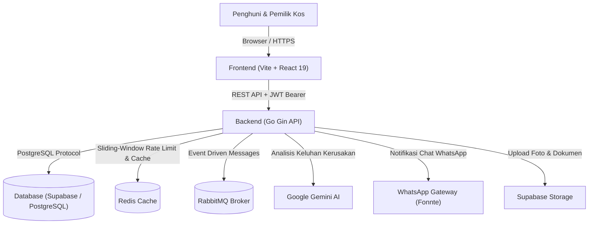

# Lapor Kos 🏠

> Platform manajemen hunian kos pintar untuk efisiensi operasional pengelola dan kemudahan transparansi bagi penghuni.

---

## 📖 Tentang Lapor Kos

**Lapor Kos** adalah sistem manajemen kos modern yang dirancang untuk menghilangkan friksi administrasi manual dalam pengelolaan rumah kos dan properti sewa. Aplikasi ini menyediakan solusi komprehensif dua arah:

* **Untuk Pemilik & Staf Properti**:
  * **Manajemen Multi-Properti**: Mendukung isolasi data antar kos dalam satu akun manajemen.
  * **Visualisasi Kamar & Okupansi**: Denah interaktif per lantai untuk melihat kamar kosong, terisi, atau dalam perbaikan.
  * **Billing Engine Otomatis**: Otomatisasi kalkulasi tagihan bulanan (sewa, listrik, air, denda) dan invoice per periode.
  * **Verifikasi Pembayaran & Kwitansi**: Validasi bukti transfer, pelacakan pelunasan, dan pencetakan kwitansi digital resmi.
  * **Triase Komplain Berbasis AI**: Menganalisis laporan kerusakan fasilitas dari penghuni secara otomatis menggunakan Google Gemini AI.
  * **Laporan Keuangan & Rekonsiliasi**: Grafik pendapatan bulanan, catatan pengeluaran, dan ekspor laporan PDF formal instan.

* **Untuk Penghuni Kos**:
  * **Portal Mandiri**: Akses rincian kamar, tanggal sewa, riwayat tagihan, dan pembayaran dari perangkat apapun.
  * **Pembayaran & Bukti Transfer**: Pembayaran tagihan dengan konfirmasi cepat dan unduhan kwitansi digital.
  * **Izin Tamu & Kerabat**: Pendaftaran kunjungan tamu dan tamu menginap dengan kode pass digital.
  * **Komplain Fasilitas**: Pelaporan keluhan kerusakan fasilitas kos disertai unggahan foto untuk penanganan cepat.
  * **Aturan Kos Digital**: Akses peraturan tata tertib hunian terbaru yang disepakati bersama.

---

## 🏛️ Arsitektur Sistem

Lapor Kos mengadopsi arsitektur **Decoupled Architecture** yang memisahkan lapisan frontend (*Single Page Application*) dengan backend (*High-Performance API Service*):



### Komponen Teknologi Utama

| Layer | Teknologi | Peran & Deskripsi |
| :--- | :--- | :--- |
| **Frontend SPA** | Vite, React 19, React Router v7, Tailwind CSS v4, TypeScript | Antarmuka pengguna ultra-responsif, instant HMR, dan rendering berbasis client. |
| **Backend API** | Go (Golang) 1.25+, Gin Gonic, pgx/v5, Gofpdf | Layanan REST API berkinerja tinggi, scheduler cron job tagihan, dan PDF generator. |
| **Database** | PostgreSQL 15+ / Supabase | Penyimpanan relasional terstruktur dengan dukungan connection pooler (PgBouncer). |
| **Cache & Queue** | Redis 7 & RabbitMQ 3.13 | Distributed rate limiting, session blacklist, dan pengolahan antrean pesan asinkron. |
| **Integrasi Eksternal** | Google Gemini AI & Fonnte WhatsApp | Triase prioritas komplain fasilitas dan pengiriman notifikasi instan ke WhatsApp penghuni. |

---

## 📁 Struktur Monorepo

```text
lapor-kos/
├── backend/            # API Server Golang (Gin, Repositori, Usecase, Migrasi SQL)
├── frontend/           # Aplikasi Web SPA (Vite, React 19, React Router, Tailwind v4)
├── scripts/ci/         # Security & Quality Release Gates (Secret scanning, audit)
├── docs/               # Dokumentasi teknis, user stories, dan arsitektur modul
├── dev.ps1             # Skrip runner lokal untuk Windows PowerShell
├── docker-compose.yml  # Konfigurasi containerization multi-service
├── go.work             # Multi-module Go Workspace
└── README.md           # Dokumentasi utama proyek
```

---

## 🚀 Panduan Memulai Cepat

Untuk petunjuk teknis langkah-demi-langkah mengenai instalasi dan cara menjalankan masing-masing bagian sistem, silakan baca dokumentasi spesifik berikut:

* 🖥️ **[Panduan Menjalankan Backend (Go API)](file:///backend/README.md)** — Menyiapkan database, konfigurasi `.env`, menjalankan migrasi, dan menyalakan API server di port `8081`.
* 🎨 **[Panduan Menjalankan Frontend (Vite + React 19)](file:///frontend/README.md)** — Menyiapkan runtime Node.js, dependensi, dan menjalankan server web di port `3000`.

---

### Menjalankan Seluruh Sistem dengan Docker Compose

Jika Anda ingin menjalankan seluruh service (Backend, Frontend, Redis, RabbitMQ) dalam satu perintah menggunakan Docker:

```bash
# 1. Salin environment docker
cp .env.docker.example .env

# 2. Build dan jalankan seluruh container di latar belakang
docker compose up -d --build
```

Setelah berjalan:
* **Frontend Web**: [http://localhost:3000](http://localhost:3000)
* **Backend API**: [http://localhost:8081](http://localhost:8081)
* **RabbitMQ Dashboard**: [http://localhost:15672](http://localhost:15672) (User: `guest`, Pass: `guest`)

---

## 📜 Lisensi

Proyek ini dilisensikan di bawah lisensi **MIT License** - lihat berkas [LICENSE](file:///LICENSE) untuk informasi lebih lanjut.
