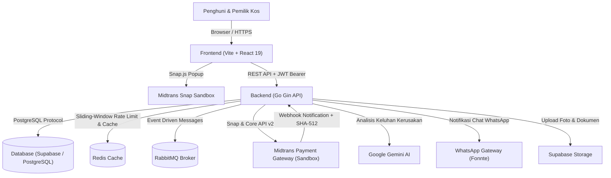

# Lapor Kos 🏠

> Platform manajemen hunian kos pintar untuk efisiensi operasional pengelola dan kemudahan transparansi bagi penghuni.

---

## 📖 Tentang Lapor Kos

**Lapor Kos** adalah sistem manajemen kos modern yang dirancang untuk menghilangkan friksi administrasi manual dalam pengelolaan rumah kos dan properti sewa. Aplikasi ini menyediakan solusi komprehensif dua arah:

* **Untuk Pemilik & Staf Properti**:
  * **Manajemen Multi-Properti**: Mendukung isolasi data antar kos dalam satu akun manajemen.
  * **Visualisasi Kamar & Okupansi**: Denah interaktif per lantai untuk melihat kamar kosong, terisi, atau dalam perbaikan.
  * **Billing Engine Otomatis**: Otomatisasi kalkulasi tagihan bulanan (sewa, listrik, air, denda) dan invoice per periode.
  * **Verifikasi Pembayaran Otomatis & Kwitansi Digital**: Pelunasan instan via **Midtrans Payment Gateway (Sandbox)** maupun validasi bukti transfer manual, lengkap dengan penerbitan kwitansi digital resmi ber-hash kriptografis (`SHA-256`).
  * **Triase Komplain Berbasis AI**: Menganalisis laporan kerusakan fasilitas dari penghuni secara otomatis menggunakan Google Gemini AI.
  * **Laporan Keuangan & Rekonsiliasi**: Grafik pendapatan bulanan, catatan pengeluaran, dan ekspor laporan PDF formal instan.

* **Untuk Penghuni Kos**:
  * **Portal Mandiri**: Akses rincian kamar, tanggal sewa, riwayat tagihan, dan pembayaran dari perangkat apapun.
  * **Pembayaran Instan (Midtrans Snap) & Transfer Manual**: Pelunasan tagihan secara *real-time* melalui Virtual Account (BCA, Mandiri, BNI, BRI, Permata), QRIS, dan GoPay/E-Wallet dengan verifikasi otomatis, atau unggah bukti transfer bank manual.
  * **Izin Tamu & Kerabat**: Pendaftaran kunjungan tamu dan tamu menginap dengan kode pass digital.
  * **Komplain Fasilitas**: Pelaporan keluhan kerusakan fasilitas kos disertai unggahan foto untuk penanganan cepat.
  * **Aturan Kos Digital**: Akses peraturan tata tertib hunian terbaru yang disepakati bersama.

---

## 🏛️ Arsitektur Sistem

Lapor Kos mengadopsi arsitektur **Decoupled & Hexagonal Architecture (Ports & Adapters)** yang memisahkan lapisan frontend (*Single Page Application*) dengan backend (*High-Performance API Service*):



### Komponen Teknologi Utama

| Layer | Teknologi | Peran & Deskripsi |
| :--- | :--- | :--- |
| **Frontend SPA** | Vite, React 19, React Router v7, Tailwind CSS v4, TypeScript | Antarmuka pengguna ultra-responsif, integrasi Midtrans Snap.js, dan rendering berbasis client. |
| **Backend API** | Go (Golang) 1.25+, Gin Gonic, pgx/v5, Gofpdf | Layanan REST API berkinerja tinggi (Hexagonal Architecture), scheduler cron job tagihan, dan PDF generator. |
| **Database** | PostgreSQL 15+ / Supabase | Penyimpanan relasional terstruktur dengan dukungan connection pooler (PgBouncer). |
| **Cache & Queue** | Redis 7 & RabbitMQ 3.13 | Distributed rate limiting, session blacklist, dan pengolahan antrean pesan asinkron. |
| **Payment Gateway** | Midtrans Snap & Core API (Sandbox) | Pembayaran online instan (VA, QRIS, E-Wallet), verifikasi webhook SHA-512, dan sinkronisasi status otomatis. |
| **Integrasi Eksternal** | Google Gemini AI & Fonnte WhatsApp | Triase prioritas komplain fasilitas dan pengiriman notifikasi instan ke WhatsApp penghuni. |

---

## 💳 Integrasi Payment Gateway Midtrans (Sandbox)

Lapor Kos mendukung **Dual Payment Flow** yang menggabungkan kemudahan pembayaran instan otomatis dengan fleksibilitas verifikasi manual:

1. **Pembayaran Instan Online (Midtrans Snap Sandbox)**:
   * **Metode Pembayaran**: Virtual Account (`BCA`, `Mandiri Bill`, `BNI`, `BRI`, `Permata`), `QRIS`, dan `GoPay / ShopeePay`.
   * **Manajemen Sesi & Ganti Metode**: Menyimpan sesi token Snap agar penghuni dapat melanjutkan pembayaran yang tertunda (*Lanjutkan Pembayaran*), atau membatalkan transaksi aktif di Midtrans secara otomatis (`POST /v2/{order_id}/cancel`) saat memilih *Ganti Metode Pembayaran*.
   * **Verifikasi Real-Time Ganda (Webhook & Auto-Sync)**:
     * **Webhook Midtrans (`POST /api/payments/webhook/midtrans`)**: Memvalidasi *signature key* `SHA-512(order_id + status_code + gross_amount + ServerKey)` secara idempoten.
     * **Real-Time Status Polling (`POST /api/payments/:id/sync-status`)**: Memeriksa status transaksi langsung ke Midtrans Core API (`GET /v2/{order_id}/status`) sehingga aplikasi di `localhost` langsung memperbarui status menjadi **Lunas (`paid`)** tanpa bergantung pada tunnel publik.
   * **Penerbitan Kwitansi Digital Otomatis**: Segera setelah status transaksi `settlement` / `capture`, sistem menerbitkan kwitansi digital resmi ber-hash `SHA-256` yang dapat langsung dilihat dan dicetak ke PDF.
2. **Transfer Bank Manual & Upload Bukti (Fallback / Cicilan Parsial)**:
   * Mendukung pembayaran penuh maupun parsial dengan unggahan foto resi transfer untuk diverifikasi oleh pemilik/staf kos.
   * Saat bukti transfer manual sedang dalam status **Menunggu Verifikasi (`pending`)**, tombol pembayaran dikunci secara otomatis untuk mencegah pembayaran ganda (*double payment*).

### Konfigurasi Environment Midtrans

Tambahkan variabel berikut pada `backend/.env`:
```env
MIDTRANS_SERVER_KEY=SB-Mid-server-xxxxxxxxxxxxxxxxxxxxxxxx
MIDTRANS_CLIENT_KEY=SB-Mid-client-xxxxxxxxxxxxxxxxxxxxxxxx
MIDTRANS_IS_PRODUCTION=false
```

Dan pada `frontend/.env`:
```env
VITE_MIDTRANS_CLIENT_KEY=SB-Mid-client-xxxxxxxxxxxxxxxxxxxxxxxx
```

> 💡 **Simulasi Pembayaran Sandbox**: Salin Nomor Virtual Account atau kode QRIS dari popup Midtrans Snap pada halaman **Tagihan & Pembayaran Saya**, lalu selesaikan simulasi pembayaran melalui **[Midtrans Sandbox Payment Simulator](https://simulator.sandbox.midtrans.com/)**.

---

## 📁 Struktur Monorepo

```text
lapor-kos/
├── backend/            # API Server Golang (Gin, Repositori, Usecase, Migrasi SQL)
├── frontend/           # Aplikasi Web SPA (Vite, React 19, React Router, Tailwind v4)
├── scripts/ci/         # Security & Quality Release Gates (Secret scanning, audit)
├── docs/               # Dokumentasi teknis, user stories, dan arsitektur modul
├── dev.ps1             # Skrip runner lokal untuk Windows PowerShell
├── docker-compose.yml  # Konfigurasi containerization multi-service
├── go.work             # Multi-module Go Workspace
└── README.md           # Dokumentasi utama proyek
```

---

## 🚀 Panduan Memulai Cepat

Untuk petunjuk teknis langkah-demi-langkah mengenai instalasi dan cara menjalankan masing-masing bagian sistem, silakan baca dokumentasi spesifik berikut:

* 🖥️ **[Panduan Menjalankan Backend (Go API)](file:///backend/README.md)** — Menyiapkan database, konfigurasi `.env`, menjalankan migrasi, dan menyalakan API server di port `8081`.
* 🎨 **[Panduan Menjalankan Frontend (Vite + React 19)](file:///frontend/README.md)** — Menyiapkan runtime Node.js, dependensi, dan menjalankan server web di port `3000`.

---

### Menjalankan Seluruh Sistem dengan Docker Compose

Jika Anda ingin menjalankan seluruh service (Backend, Frontend, Redis, RabbitMQ) dalam satu perintah menggunakan Docker:

```bash
# 1. Salin environment docker
cp .env.docker.example .env

# 2. Build dan jalankan seluruh container di latar belakang
docker compose up -d --build
```

Setelah berjalan:
* **Frontend Web**: [http://localhost:3000](http://localhost:3000)
* **Backend API**: [http://localhost:8081](http://localhost:8081)
* **RabbitMQ Dashboard**: [http://localhost:15672](http://localhost:15672) (User: `guest`, Pass: `guest`)

---

## 📜 Lisensi

Proyek ini dilisensikan di bawah lisensi **MIT License** - lihat berkas [LICENSE](file:///LICENSE) untuk informasi lebih lanjut.
